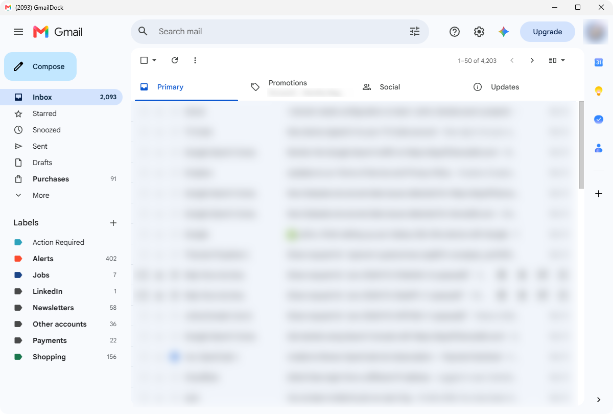

<div align="center">
  

  # GmailDock

  Fast, lightweight Gmail on your desktop.

  [](https://github.com/nooblk-98/gmaildock/actions/workflows/build-release.yml)
  [](https://github.com/nooblk-98/gmaildock/releases)
  [](https://github.com/nooblk-98/gmaildock/releases)
  [](LICENSE)

  [](https://www.rust-lang.org/)
  [](https://tauri.app/)
  [](https://github.com/nooblk-98/gmaildock/releases)
</div>

<p align="center">
  
</p>

GmailDock opens [mail.google.com](https://mail.google.com/) in your operating system's webview. Its small Rust and Tauri shell is designed for fast startup and low app overhead while keeping Gmail's own interface. There is no Gmail API setup or OAuth client ID.

## Features

**Performance**
- No bundled browser engine. GmailDock uses the webview your system already has: WebView2 on Windows and WebKit on macOS and Linux, so downloads stay small.
- Lighter than running a whole browser just for Gmail: no browser toolbar, extensions, or other tabs running alongside it. The app shell around Gmail is written in Rust.
- Gmail itself uses about the same memory as in a browser tab, because it is the same page. The savings come from everything around it.

**Mail**
- Gmail in its own desktop window on Windows, macOS, and Linux.
- Inbox unread count on the taskbar or dock badge, in the window title, and in the tray tooltip.
- Desktop notifications for new mail and finished downloads.
- Add and switch between Google accounts using Google’s account chooser (shared browser session).

**Desktop**
- Runs in the system tray. Left-click opens Gmail; right-click for accounts, settings, updates, and Quit.
- Global shortcut to show or hide the window: Ctrl+Shift+G (Cmd+Shift+G on macOS) by default.
- Starts at login, optionally minimized to the tray.
- Remembers window size, position, and zoom.
- Opens non-Google links in your default browser.

**Settings and updates in the tray menu**
- **Preferences**: start at login, start minimized, keep running when closed, new mail notifications, link handling, and automatic update checks.
- **Zoom** from 50% to 200%, and a choice of **show or hide shortcut** (or off).
- A small **Preferences…** window (tray, or Cmd+, on macOS) for a custom shortcut, diagnostics you can copy, and resetting preferences.
- Checks for updates in the background and notifies you. **Install update** downloads it with progress in the tray tooltip, **What's new** opens the release notes, or **Skip** that version.
- **About** opens this page, and the menu shows the installed version.
- A log file and your Downloads folder, opened from **Troubleshooting**.

> [!IMPORTANT]
> Google may block sign-in inside an embedded webview. If your account is not already signed in there, Gmail may be unable to open your inbox. This behavior is controlled by Google and the installed webview.

## Customization

Open the tray icon's right-click menu for everyday options, or **Preferences…** (tray, or Cmd+, on macOS) for the custom shortcut, diagnostics, and reset.

| Option | Default | What it does |
| --- | --- | --- |
| Start at login | On | Launches GmailDock when you sign in to your computer. |
| Start minimized | Off | Starts in the tray instead of showing the window at login. |
| Keep running when closed | On | Closing the window hides it to the tray; turn off to quit on close. |
| New mail notifications | On | Shows a desktop notification when your Inbox unread count increases. |
| Open links in default browser | On | Non-Google links open in your browser instead of inside GmailDock. |
| Check for updates | On | Checks in the background and notifies you; you can install or skip a version. |
| Zoom | 100% | 50% to 200%; remembered between launches. |
| Show/hide shortcut | Ctrl+Shift+G (Cmd+Shift+G on macOS) | Global shortcut to show or hide the window. Change or turn it off in Preferences…. |

GmailDock also remembers window size and position. Gmail's own settings control themes, signatures, and mail behavior.

## Download

Download installers from the [Releases page](https://github.com/nooblk-98/gmaildock/releases). Pull request builds are available as artifacts on the [Actions page](https://github.com/nooblk-98/gmaildock/actions/workflows/build-release.yml).

### Which file do I need?

| Your system | Download | Status |
| --- | --- | --- |
| Windows 10/11 (64-bit) | `GmailDock_<version>_x64-setup.exe` (or the `.msi`) | Tested |
| Windows on ARM | `GmailDock_<version>_arm64-setup.exe` | Builds, community-tested |
| macOS, Apple Silicon (M1 or newer) | `GmailDock_<version>_aarch64.dmg` | Builds, community-tested |
| macOS, Intel | `GmailDock_<version>_x64.dmg` | Builds, community-tested |
| Debian, Ubuntu (64-bit) | `GmailDock_<version>_amd64.deb` | Builds, community-tested |
| Fedora, RHEL, openSUSE (64-bit) | `GmailDock-<version>-1.x86_64.rpm` | Builds, community-tested |
| Any Linux (64-bit) | `GmailDock_<version>_amd64.AppImage` | Builds, community-tested |
| Linux on ARM64 | `.deb`, `.rpm`, or `.AppImage` with `aarch64` or `arm64` in the name | Builds, community-tested |

"Community-tested" means the release workflow builds these packages but the maintainer can only test on Windows. Please report what works and what does not. Unsigned builds may show security warnings; see [TROUBLESHOOTING.md](TROUBLESHOOTING.md).

## Run from source

Install [Rust](https://rustup.rs/), Node.js, and the [Tauri 2 prerequisites](https://v2.tauri.app/start/prerequisites/) for your operating system. Then run:

```sh
git clone https://github.com/nooblk-98/gmaildock.git
cd gmaildock
npm ci
npm run dev
```

To build a local installer, run `npm run build`. The bundles are written under `src-tauri/target/release/bundle/`.

## Troubleshooting

Security warnings, Linux tray and shortcut issues, notifications, and uninstalling are covered in [TROUBLESHOOTING.md](TROUBLESHOOTING.md).

## Testing and contributing

GmailDock is currently tested hands-on on Windows. The release workflow builds macOS and Linux packages, but those platforms need more real-world testing. If you use macOS or Linux, please try a release and [open an issue](https://github.com/nooblk-98/gmaildock/issues) with your OS version, package type, steps to reproduce, and any error you see.

See [CONTRIBUTING.md](CONTRIBUTING.md) for setup, checks, and the release process. Issue templates ask for the details testers need to share. Contributions are welcome, especially for macOS and Linux compatibility, account sign-in behavior, accessibility, and the update experience. Please open an issue or pull request in the [repository](https://github.com/nooblk-98/gmaildock).

## Releases and updates

The [release workflow](.github/workflows/build-release.yml) builds Windows, macOS, and Linux packages. A version tag creates a signed release and `latest.json` for the in-app updater. The updater checks this repository's [latest release](https://github.com/nooblk-98/gmaildock/releases/latest).

Maintainers: run `npm run release -- X.Y.Z` to bump every version file and draft `.github/release-notes/vX.Y.Z.md` from commit messages, edit the notes, then commit and push a matching tag (or add `--push`). The notes are included in the release and updater manifest. The repository's `TAURI_SIGNING_PRIVATE_KEY` Actions secret is configured; keep the private key outside the repository. Forks need their own signing key, matching updater public key, and release endpoint.

## Privacy

GmailDock only wraps the Gmail website. It does not read, upload, or store your mail, and it has no servers of its own. The only data it saves locally is a small settings file (update, tray, notification, link, zoom, and startup preferences) and a log file used for troubleshooting. Your Google session lives in the system webview, as in a browser. The updater contacts GitHub to look for new releases.

## Security

To report a vulnerability, see [SECURITY.md](SECURITY.md).

## About this project

GmailDock is an independent, unofficial wrapper. It is not affiliated with or endorsed by Google. The icon adapts Google's [Gmail artwork](https://knowledge.workspace.google.com/admin/getting-started/brand-your-internal-communications-with-google-workspace). The account-menu adjustment depends on Google's page markup and may need changes when Gmail updates its interface.

Inspired by [whatRust](https://github.com/karem505/whatRust).
